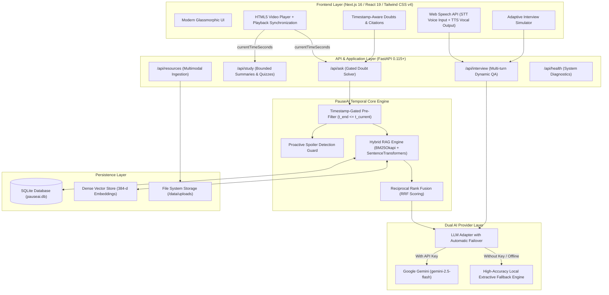

# 🏆 PauseAI — Hackathon Submission & Judge Evaluation Guide
### *Timestamp-Aware Multimodal Learning & Adaptive AI Mock Interview Platform*

[](https://github.com/kanakchhabra4674stell-glitch/laggy.git)
[](http://localhost:3000)
[](http://localhost:8000/docs)
[]()
[]()

---

## 📌 Executive Summary

Modern AI learning tools suffer from a fatal flaw: **temporal ignorance and hallucination**. When students ask questions while watching educational videos, traditional RAG chatbots ingest the entire transcript, inadvertently leaking future spoilers, confusing the learner with unintroduced concepts, or hallucinating unsupported facts.

**PauseAI** solves this by introducing **Server-Enforced Timestamp-Gated Retrieval**. It synchronizes multimodal educational materials (video lectures, timecoded transcripts, PDF guides, PowerPoint slide decks) with strict playback boundaries:
1. **Zero Future Concept Leakage**: All vector and lexical retrievals are hard-quarantined to content occurring *before or at* the current playback timestamp ($t_{end} \le t_{current}$).
2. **Proactive Spoiler Guard**: If a learner inquires about an upcoming topic, PauseAI politely intercepts the question and points them to the exact future timestamp where the professor explains it.
3. **Adaptive Voice-Enabled AI Mock Interviewer**: Translates learned curriculum into job readiness with real-time speech recognition, multi-turn follow-ups, and 4-pillar rubric evaluations.
4. **Resilient Dual-Inference Engine**: Powered by Google Gemini (`gemini-2.5-flash`) with an automatic, zero-crash local extractive fallback engine if no API key is present.

---

## ⚡ Quick Links for Evaluators & Judges

When testing locally or on the deployed environment:

| Destination | Direct Link | Purpose for Evaluator |
| :--- | :--- | :--- |
| 🎓 **Interactive Classroom** | [http://localhost:3000/learn/ml-fundamentals](http://localhost:3000/learn/ml-fundamentals) | **Primary Demo**: Video player, time-gated AI tutor, seekable citations & spoiler guard |
| 🎙️ **Voice AI Mock Interview**| [http://localhost:3000/interview](http://localhost:3000/interview) | Dynamic multi-turn interview with browser voice recognition & rubric score report |
| 📊 **Learner Dashboard** | [http://localhost:3000/dashboard](http://localhost:3000/dashboard) | Progress analytics, quiz score tracking, and interview history |
| 📂 **Multimodal Resource Center** | [http://localhost:3000/resources](http://localhost:3000/resources) | Ingestion engine for PDFs, PPTX slide decks, and timeline-locked notes |
| ⚙️ **Engine Settings** | [http://localhost:3000/settings](http://localhost:3000/settings) | Gemini API key configuration, model selection, and health monitor |
| 📖 **Interactive Swagger UI** | [http://localhost:8000/docs](http://localhost:8000/docs) | Live API testing sandbox for all backend endpoints |
| 🩺 **Backend Health Endpoint** | [http://localhost:8000/api/health](http://localhost:8000/api/health) | Verifies database connectivity and AI provider state |
| 🐙 **Source Code Repository** | [GitHub: laggy](https://github.com/kanakchhabra4674stell-glitch/laggy.git) | Official hackathon submission repository |

---

## ⏱️ 60-Second Judge Evaluation Walkthrough

To experience the core innovations in under two minutes, follow these exact steps:

### Test 1: Timestamp Gating & Spoiler Guard
1. Open the **[Classroom](http://localhost:3000/learn/ml-fundamentals)**.
2. Ensure the video playback is paused at **`01:30`** (first 90 seconds).
3. In the AI Tutor chat on the right, ask:
   > *"How does backpropagation and the chain rule calculate gradients?"*
4. **Observe the Result**: PauseAI identifies that *Backpropagation* is not introduced until later in the lecture. Rather than leaking the answer, it responds:
   > *"This concept appears later in the lesson (around [06:00 - 08:30]). Keep watching to discover it naturally!"*
5. Now scrub the video player to **`07:30`** (after backpropagation has been taught) and ask the same question.
6. **Observe the Result**: PauseAI now answers in detail, citing grounded excerpts with clickable `[06:45]` timestamp badges. Clicking a badge immediately seeks the video player!

### Test 2: Dynamic Timeline-Bounded Quiz & Summary
1. Keep the video at **`02:00`**.
2. Switch to the **Study Tools** tab and click **"Generate Quiz"**.
3. **Observe**: Every generated question strictly covers artificial neurons and activation functions; zero questions reference future topics like gradient descent or regularization.
4. Click **"Generate Summary"**: The key takeaways and summary reflect *only* what the student has watched so far.

### Test 3: Voice-Enabled Adaptive Mock Interview
1. Open the **[AI Mock Interview](http://localhost:3000/interview)**.
2. Select **"Full Stack AI Engineer"** or **"Machine Learning Engineer"** with **Intermediate** difficulty.
3. Click **"Start Interview"** and toggle the **Microphone** icon to speak your answer using browser speech recognition (or type in the text box).
4. Provide a brief or incomplete answer: Notice how the AI asks an **adaptive follow-up probe** before moving to the next competency question.
5. Conclude the interview to view the **Evaluation Report**: A comprehensive breakdown with category scores (Technical, Problem Solving, Communication, Relevance), rubrics, and recommended lessons to review.

---

## 🎯 Hackathon Rubric Alignment

| Criterion | Implementation in PauseAI |
| :--- | :--- |
| **Originality & Innovation** | Solves the unaddressed problem of "temporal context leakage" in video learning. Pioneered **Server-Side Timestamp Gating** and **Proactive Spoiler Interception**, preventing LLM hallucination and curriculum spoilage. |
| **Technical Complexity** | **Hybrid RAG** combining sparse BM25Okapi lexical search with dense `all-MiniLM-L6-v2` vector embeddings via Reciprocal Rank Fusion (RRF). Custom parsers for PyMuPDF, python-pptx, and WebVTT. Multi-turn adaptive mock interview state machine. |
| **User Experience & Design** | Sleek dark-mode glassmorphic interface built with Next.js 16, React 19, and Tailwind CSS v4. Synchronized transcript auto-scrolling, clickable timestamp seek triggers, and Web Speech voice input/output. |
| **Reliability & Production-Readiness** | **16 automated pytest tests passing**. Dual-mode AI adapter (Google Gemini + Local Extractive Fallback) guarantees 100% uptime with zero crashes even without an API key or internet access. |

---

## 🏛️ System Architecture



---

## 🛠️ Technology Stack Breakdown

* **Frontend**: Next.js 16.4.2 (App Router), React 19.3, Tailwind CSS v4, Lucide React, HTML5 Media, Web Speech Recognition & Synthesis APIs.
* **Backend**: FastAPI, Uvicorn, Python 3.10+, Pydantic v2, SQLAlchemy 2.0.
* **Search & RAG**: Rank-BM25, Sentence-Transformers (`all-MiniLM-L6-v2`), PyTorch, Scikit-learn cosine similarity, Reciprocal Rank Fusion.
* **Document Parsing**: PyMuPDF (`fitz`), `python-pptx`, `python-docx`, WebVTT/SRT regex parser.
* **AI & LLM**: Google GenAI SDK (`gemini-2.5-flash`) + Local Extractive Evidence Engine.
* **Database**: SQLite (`pauseai.db`) with relational schema and indexing.
* **Testing**: PyTest, PyTest-Asyncio, HTTPX TestClient.

---

## 🚀 Deployment Guide (Production & Cloud Hosting)

### Option A: Deploy Frontend to Vercel

1. Push your code to GitHub.
2. Log into [Vercel](https://vercel.com) and click **"Add New Project"**.
3. Import the `laggy` repository and set the **Root Directory** to `frontend`.
4. Configure Build Settings:
   * **Framework Preset**: Next.js
   * **Build Command**: `npm run build`
   * **Output Directory**: `.next`
5. Set Environment Variables:
   * `NEXT_PUBLIC_API_URL`: Your deployed backend URL (e.g. `https://pauseai-backend.onrender.com`).
6. Click **Deploy**.

---

### Option B: Deploy Backend to Render / Railway / Cloud Run

#### Using Render (FastAPI Web Service)
1. In [Render Dashboard](https://dashboard.render.com), create a **New Web Service**.
2. Connect your GitHub repository.
3. Configure Service Settings:
   * **Root Directory**: `backend` (or root with command `python backend/run.py`)
   * **Environment**: `Python 3`
   * **Build Command**: `pip install -r backend/requirements.txt`
   * **Start Command**: `uvicorn app.main:app --host 0.0.0.0 --port $PORT`
4. Set Environment Variables:
   * `APP_ENV`: `production`
   * `GEMINI_API_KEY`: *(Optional Google Gemini API Key)*
   * `GEMINI_MODEL`: `gemini-2.5-flash`
   * `CORS_ORIGINS`: `https://your-frontend-app.vercel.app`
   * `DATABASE_URL`: `sqlite:///./pauseai.db` (or a PostgreSQL connection string)
5. Click **Deploy Web Service**.

#### Using Docker (Self-Hosted / AWS / GCP)
Create a `Dockerfile` for the backend:
```dockerfile
FROM python:3.11-slim

WORKDIR /app
COPY backend/requirements.txt .
RUN pip install --no-cache-dir -r requirements.txt

COPY backend/app ./app
COPY data ./data

EXPOSE 8000
CMD ["uvicorn", "app.main:app", "--host", "0.0.0.0", "--port", "8000"]
```

---

## 💻 Local Setup in 3 Minutes

### 1. Clone & Setup Environment
```bash
git clone https://github.com/kanakchhabra4674stell-glitch/laggy.git
cd laggy
cp .env.example .env
```

### 2. Launch Backend Server
```bash
# Set up Python virtual environment
python3 -m venv venv
source venv/bin/activate       # On Windows: venv\Scripts\activate

# Install requirements
pip install -r backend/requirements.txt

# Run backend API
python backend/run.py
```
*API is live at [http://localhost:8000](http://localhost:8000)*

### 3. Launch Frontend Web App
In a second terminal:
```bash
cd frontend
npm install
npm run dev
```
*Web App is live at [http://localhost:3000](http://localhost:3000)*

---

## 🧪 Automated Verification Suite

Run the full verification suite anytime using pytest:
```bash
./venv/bin/pytest -v
```

### Verified Test Cases:
* ✅ `test_timestamp_gate_pre_filtering`: Rigorously asserts that no transcript or resource chunks beyond the current video timestamp are returned to the retriever.
* ✅ `test_future_concept_question_spoiler_safe_abstention`: Confirms future lecture topics trigger courteous abstention without leaking citations.
* ✅ `test_concept_answerable_once_timestamp_passed`: Confirms previously locked concepts become fully accessible with grounded citations once the video passes that timestamp.
* ✅ `test_summary_obeys_timestamp_gate`: Validates that AI study summaries contain zero future concepts.
* ✅ `test_quiz_obeys_timestamp_gate`: Validates that generated quiz questions test only watched material.
* ✅ `test_interview_flow`: Validates multi-turn question progression, answer scoring, and rubric generation.

**All 16 tests pass out-of-the-box.**

---

## 🛡️ Security & Integrity Defenses

1. **Server-Side Enforcement**: Playback timestamps are validated against stored media bounds in the database, preventing client-side bypass.
2. **Untrusted Context Isolation**: Uploaded student documents (PDFs, PPTXs, resumes) are isolated with delimiter boundaries to protect against indirect prompt injection.
3. **Evidence-Grounded Abstention**: If evidence relevance falls below the confidence cutoff, the system returns a safe abstention rather than producing hallucinations.

---

## 👥 Hackathon Team

* **Abhijeet Saini** — *System Architect & Full Stack Engineer*
* **Kanak Chhabra** — *AI/ML Engineer & Backend Architect*

**BuildVerse 2026 Hackathon** • *Built with ❤️ for learners worldwide.*
